# Architecture

How the workspace is built, where the boundaries run, and which rules a change is judged against.
What the platform is for: [`README.md`](./README.md). Contracts that cross a boundary:
[`API.md`](./API.md). What proves it: [`TESTING.md`](./TESTING.md). What is built and in what order:
[`ROADMAP.md`](./ROADMAP.md). The deep dives: [`domains/`](./domains/README.md).

---

## 1. Invariants

Ten properties that hold everywhere in the tree. Each is stated as a prohibition, because a rule
phrased as advice is a rule that gets discussed rather than followed, and each says where the check
lives — a rule no machine checks is a preference.

### 1.1. A crate depends downward only

Five layers, and a crate of layer N depends on layers below N. An upward dependency is an
architectural error and does not pass review.

| Layer | Crates | What the layer may not do |
|---|---|---|
| 5 · products | `sting-cli`, `sting-abi-cli`, `sting-abi-service` | hold analysis; it wires and prints |
| 4 · subject | `sting-detectors`, `sting-scamcheck` | import another subject crate |
| 3 · analysis | `sting-semantic`, `sting-dataflow` | perform I/O |
| 2 · parsing | `sting-ast`, `sting-abi-core`, `sting-abi-*` | swallow a parse failure |
| 1 · foundation | `sting-core`, `sting-corpus`, `sting-emulator`, `sting-emulator-sys`, `sting-tolkc`, `sting-fift` | know what a defect is |

The two domains that arrived whole declare their own layers, because a wind tunnel and a clustering
pipeline are stacks rather than single crates:

| Domain | Layers, lowest first |
|---|---|
| **sybil** | types · store · ingestion · graph · features, scorer · cluster, api · python |
| **karman** | types · core · scenario · mechanisms, data, report, tvm · agents · verify · app · cli, python |

**Enforced by** `make lint`, which reads every manifest against those tables: a library dependency
may only point down, and a crate that names its own layer is two crates at one level that now know
about each other. A test dependency may point sideways — a test is allowed to drive a sibling — and
upwards only where the edge is named with its reason. Also by §8.1's dead-edge sweep and by the
graph in §3, which is updated in the same commit as the manifest that changes it.

### 1.2. A declared dependency is a used dependency

An edge in a manifest that no source file uses is deleted. A review found two such edges, and the
audit that followed found ten more — including two the graph in this document had been drawing as
real for months.

**Enforced by** §8.1: the sweep prints every declared `sting-*` dependency whose crate identifier
appears in no `.rs` file of the dependent crate, and its output has to be empty.

### 1.3. `unsafe` lives in two crates, with different rights

`sting-emulator-sys` is the raw FFI boundary and carries `unsafe` without restriction.
`sting-emulator` is its safe wrapper: `unsafe` is permitted, and **no public function there may be
`unsafe fn`** — callers see `TvmEmulator`, `TransactionEmulator` and `Result<_, EmulatorError>` and
nothing else. Every other crate declares `unsafe_code = "forbid"`, `sting-tolkc` and `sting-fift`
included: those two integrate an external TON tool through a subprocess and files, which is not an
FFI boundary and does not earn the exception.

The first version of this rule said "`unsafe` only in `sting-emulator-sys`" and was unfollowable —
a safe wrapper cannot call an `unsafe fn` without an `unsafe` block of its own.

**Enforced by** `[workspace.lints.rust] unsafe_code = "forbid"` and `undocumented_unsafe_blocks =
"deny"`. `forbid` cannot be relaxed by an inner attribute — that is the point of it, and also its
price: the two crates cannot inherit the workspace table at all, since Cargo refuses to mix
inheritance with a local override. They copy it, and `make lints-check` compares every copy against
the workspace, allowing each of them exactly one named difference. A third crate that copies the
table fails the check rather than passing quietly.

### 1.4. A library never panics as a way of returning

`unwrap_used`, `expect_used` and `panic` are denied workspace-wide, and no crate buys itself an
exception with `#[allow]`. Errors are typed per crate with `thiserror`; `anyhow` appears only at the
top of a binary.

The lint does not see `assert!` or slice indexing, and one place in the tree had been relying on
convention rather than on the tool: `Cfg::new` in `sting-dataflow` asserted on a malformed graph
request. It returns `Result<Self, CfgError>` now. `Cfg::block` and `Cfg::predecessors` were
deliberately left indexing, because their indices come from an already-validated `Cfg` — the same
guarantee that makes indexing a `Vec` after checking its length safe.

**Enforced by** `[workspace.lints.clippy]` and by review for the two constructs the lint cannot see.

### 1.5. Input is validated at the boundary and trusted inside

CLI arguments, configuration, an HTTP body, a toncenter response — validated where they arrive.
Internal invariants between our own crates are not re-checked: a `Finding` that has been built is a
trusted value from then on.

### 1.6. Refusal and uncertainty are types, not strings in a log

A tool that guesses where it does not know is worse than one that says so. Dynamic verification has
three outcomes rather than two — `Confirmed`, `Refuted`, `Inconclusive(reason)` — and a jetton probe
has more (§7.1). `Refuted` does not delete a finding; the report lowers its rendered severity.

### 1.7. A file that is not parsed never looks like a file without findings

An `ERROR` or `MISSING` node is reported with its position and the command exits non-zero. Silence
means "read and clean", and it may not mean anything else.

**Enforced by** the parse-share check in `make pr`.

### 1.8. A number in a document is derived, not typed

Crates, tests, detectors, dictionary size, corpus size and both aggregate precisions are computed
from the tree. A claim about the whole tree is written in one canonical form so that the check can
find it.

**Enforced by** `make numbers-check`, which is part of `make lint`.

### 1.9. A threshold is registered before the run it judges

A threshold named after the numbers are in is not a threshold. A negative result is published in the
same table as a positive one, at the same size.

### 1.10. English in code, both languages in documentation

Code, comments, doc comments, error text, commit messages and issues are English. `docs/` is English
and canonical; `docs/ru/` is an identical mirror with the same heading tree, and both sides change in
the same commit.

**Enforced by** `make docs-check`, which compares the heading trees and counts Russian prose in
sources.

---

## 2. Five contours, one workspace

`sting` began as one tool — a static analyser for Tolk. Five product contours live in `crates/`
today, and that is not the residue of a restructuring: **every one of them ends up needing the same
two things, to parse a TON contract and to execute one.**

| Contour | What it does | Binary | Crates |
|---|---|---|---|
| **security** | finds defects in Tolk source and confirms them by running the real bytecode in a TVM | `sting` | `sting-core`, `-ast`, `-dataflow`, `-semantic`, `-detectors`, `-report`, `-pipeline`, `-bench`, `-benchmark`, `-fuzz`, `-cli` |
| **abi-layer** | extracts a normalised contract schema and serves it over a CLI and HTTP | `abi-layer`, `sting-abi-service` | twelve `sting-abi-*` crates |
| **scamcheck** | risk signals for jettons and for Gift/NFT collections | `sting-scamcheck`, `gift_trust_check` | `sting-scamcheck` |
| **sybil** | who funded whom, what a wallet looks like as numbers, which cluster it is in, and a score served over HTTP | `sting-sybil-ingestion`, `-features`, `-cluster`, `-api` | eight `sting-sybil-*` crates |
| **karman** | mechanisms as deterministic state machines, agents that trade against them, and what a run is allowed to claim | `karman` | fifteen `sting-karman-*` crates |
| **foundation** | the Tolk compiler, the TVM emulator, chain access, Fift | — | `sting-tolkc`, `-emulator-sys`, `-emulator`, `-corpus`, `-fift`, `-chain`, `-address`, `-tep` |

**Where the construction pays for itself.** `sting-tolkc` was written for the cross-file call
resolution that `AC` and `GVR` need — and the `abi.json` and `symbolTypes.json` it already parses are
exactly the raw source the abi-layer's Tolk extractor normalises. `sting-emulator` was written to
confirm findings dynamically — and it is what runs the jetton honeypot probe in scamcheck, the
dictionary probe in abi-layer, and the get-method the wind tunnel asks a real contract. `sting-chain`
was written once and is what the clustering contour reaches mainnet through. No contour paid for the
foundation alone, and each of them uses it.

The other side is recorded just as plainly: **a shared foundation is not a shared roadmap.** No
milestone of one contour blocks a milestone of another, and the only couplings between contours are
the four nodes in §3.1.

---

## 3. The crate graph

Acyclic by construction. Five crates have no internal dependencies at all — `sting-core`,
`sting-dataflow`, `sting-emulator-sys`, `sting-abi-core`, `sting-corpus` — each for its own reason
(§3.2).

The graph is **complete rather than illustrative**: it carries exactly the edges that are declared in
a manifest *and* used in code (§1.2).

```mermaid
graph TD
    subgraph FOUNDATION
        tolkc[sting-tolkc]
        esys[sting-emulator-sys]
        emu[sting-emulator] --> esys
        corpus[sting-corpus]
        fift[sting-fift] --> tolkc
    end

    subgraph SECURITY
        core[sting-core]
        dataflow[sting-dataflow]
        ast[sting-ast] --> core
        report[sting-report] --> core
        detectors[sting-detectors] --> core
        detectors --> ast
        detectors --> dataflow
        detectors --> tolkc
        pipeline[sting-pipeline] --> core
        pipeline --> ast
        pipeline --> detectors
        pipeline --> report
        pipeline --> corpus
        pipeline --> emu
        pipeline --> esys
        pipeline --> tolkc
        semantic[sting-semantic] --> ast
        semantic --> tolkc
        bench[sting-bench] --> core
        bench --> ast
        bench --> detectors
        bench --> pipeline
        benchmark[sting-benchmark] --> core
        benchmark --> bench
        benchmark --> detectors
        benchmark --> pipeline
        hunt[sting-hunt] --> detectors
        hunt --> pipeline
        fuzz[sting-fuzz] --> emu
        fuzz --> esys
        cli[sting-cli] --> core
        cli --> detectors
        cli --> pipeline
        cli --> bench
        cli --> corpus
        cli --> emu
    end

    subgraph ABI-LAYER
        acore[sting-abi-core]
        atact[sting-abi-tact] --> acore
        afunc[sting-abi-func] --> acore
        apipe[sting-abi-pipeline] --> acore
        atolk[sting-abi-tolk] --> acore
        atolk --> tolkc
        adict[sting-abi-dictionary] --> acore
        adict --> emu
        adict --> esys
        acov[sting-abi-coverage] --> adict
        acov --> corpus
        abench[sting-abi-bench] --> acore
        abench --> atolk
        abench --> atact
        abench --> afunc
        abench --> tolkc
        areg[sting-abi-registry] --> acore
        areg --> apipe
        areg --> atolk
        areg --> atact
        areg --> corpus
        areg --> fift
        areg --> tolkc
        asvc[sting-abi-service] --> acore
        asvc --> apipe
        asvc --> areg
        asvc --> adict
        asvc --> atolk
        asvc --> atact
        asvc --> afunc
        asvc --> corpus
        asvc --> emu
        asvc --> esys
        asvc --> fift
        asvc --> tolkc
        acli[sting-abi-cli] --> acore
        acli --> apipe
        acli --> abench
        acli --> acov
        acli --> adict
        acli --> atolk
        acli --> atact
        acli --> afunc
        acli --> corpus
        acli --> emu
        acli --> tolkc
        aprof[sting-abi-profiler] --> acore
        aprof --> abench
        aprof --> adict
        aprof --> atolk
        aprof --> atact
        aprof --> afunc
        aprof --> corpus
        aprof --> emu
        aprof --> esys
        aprof --> tolkc
    end

    scam[sting-scamcheck] --> corpus
    scam --> emu
    scam --> esys
```



### 3.1 The four shared nodes

The overlap between contours is not a blurred boundary: it is four crates of the foundation that
both branches consume, each for a stated reason.

| Shared node | Consumed from security | Consumed from abi-layer | Why one of it |
|---|---|---|---|
| `sting-tolkc` | `-detectors`, `-pipeline`, `-semantic` | `-abi-tolk`, `-abi-bench`, `-abi-cli`, `-abi-registry`, `-abi-service`, `-abi-profiler` | one Tolk compiler for everyone — the abi-layer **reads** its types rather than forking them |
| `sting-emulator` | `-pipeline`, `-cli`, `-fuzz` | `-abi-dictionary`, `-abi-cli`, `-abi-service`, `-abi-profiler` | one binding to `libemulator` that releases what it allocates (§6.2) |
| `sting-emulator-sys` | `-pipeline`, `-fuzz` | `-abi-dictionary`, `-abi-service`, `-abi-profiler` | one FFI boundary; some consumers hold `LibEmulator` directly rather than through the wrapper |
| `sting-corpus` | `-pipeline`, `-cli` | `-abi-coverage`, `-abi-registry`, `-abi-service`, `-abi-cli`, `-abi-profiler` | one HTTP client, one disk cache, one `CorpusController` |

There was a fifth node, and it was there by mistake. Four abi-layer crates depended on the security
branch's orchestration crate for **three names** — `CorpusController`, `FetchOptions`, `CorpusError`
— and through that one edge the abi-layer pulled in the detectors, the report renderer, the AST and
the dataflow solver. `CorpusController` had been written for `sting fetch` and stayed in
`sting-pipeline` out of inertia, although everything it orchestrates lives in `sting-corpus`. It
moved; `sting-pipeline` re-exports it, so no caller noticed. One command says whether the edge is
back, and it has to print nothing:

```sh
cargo tree -p sting-abi-service | grep -E 'sting-detectors|sting-report|sting-ast|sting-dataflow'
```

`sting-fift` also lives in the foundation without being a shared node — only `-abi-registry` and
`-abi-service` consume it. It is there because it belongs to neither branch, not because both need
it.

### 3.2 Why five crates depend on nothing

- **`sting-core`** — the security contour's vocabulary: `DefectClass`, `Severity`, `Finding`,
  `Location`, `Confidence`, `StingConfig`. An outward dependency from here would turn the graph into
  a mesh, and a change to `Finding` already reaches everything above it.
- **`sting-abi-core`** — the normalised schema. It has to be independent of which extractor filled
  it, or normalisation means nothing. It is **not** a copy of `sting-core` for another contour: the
  two share no type.
- **`sting-dataflow`** — a textbook generic worklist solver (`Semilattice`, `Transfer`,
  `WorklistSolver`) that knows nothing about Tolk.
- **`sting-emulator-sys`** — the raw FFI boundary. A dependency from here would mean the raw layer
  knows something about the domain.
- **`sting-corpus`** — HTTP clients, cache and controller. `Finding` appears nowhere in its
  signatures, which is what lets the abi-layer consume it without pulling in a defect taxonomy.

Three of the five were holding a declared but never used dependency on `sting-core`, and all three
manifests contradicted their own crate documentation and this section. That is where §1.2 comes
from.

### 3.3 Why orchestration is a crate rather than a module in the CLI

`sting-pipeline` and `sting-abi-pipeline` exist so that orchestration is testable **without `clap`
and without a binary**. The gain is measurable rather than aesthetic: `sting-bench` drives the same
`LintController` the CLI drives, so a measured precision describes the code the user will run and not
a second copy of it.

---

## 4. Repository layout

```
sting/
├── Cargo.toml                  # workspace members, [workspace.dependencies], [workspace.lints]
├── rust-toolchain.toml         # one pinned toolchain for the whole tree
├── clippy.toml · deny.toml · rustfmt.toml · typos.toml · lefthook.yml
├── Makefile                    # the gate: make pr
├── Dockerfile.abi-service      # the one containerised contour
├── .github/workflows/          # what CI runs, see TESTING.md §8
├── crates/                     # the graph in §3
├── corpus/                     # security: clean projects, golden fixtures, baseline.json
├── corpus-abi/                 # abi-layer: Tact/FunC corpora, method-dictionary.json, baseline.json
├── vendor/                     # tolk, tact, libemulator, fift, tree-sitter-func — see DATA.md §2
├── scripts/                    # the mechanical checks
└── docs/                       # this directory, with its mirror in docs/ru/
```

The layout follows [matklad, *Large Rust Workspaces*](https://matklad.github.io/2021/08/22/large-rust-workspaces.html):
a flat `crates/`, directory name equal to crate name, internal crates at `version = "0.0.0"`, and
everything shared inherited through `[workspace.package]` and `[workspace.dependencies]`.

That dependency table was not written pre-emptively. It exists because drift was found: `serde_json`
was pinned at `1.0.145` in some crates and `1.0.150` in others. `Cargo.lock` unified the version at
build time, so it never broke anything — which is exactly the silent class the table is for. The
internal `sting-*` crates are listed in it for the same reason, not only the external ones.

**A dependency with a single consumer stays declared locally.** Centralising for symmetry is
speculation.

---

## 5. The corpus is the centre, not the margin

In static security analysis **the truth is not derived from a specification**. There is no way to
prove that `AC` is "correct": correctness here is the share of real code it is right about, not a
property of the algorithm.

One consequence shapes the whole construction:

> **The only way to test a detector is to run it over real code that was not written for it, and to
> read every hit by hand.**

That has been applied repeatedly, and each time it produced something a design on paper would not
have:

- **`UR`** was designed iteratively rather than up front: the first version, with three guard forms,
  produced seventeen false positives on the clean corpus. Each of the four forms added afterwards
  came from a specific real site. The single remaining "false positive" turned out to be a real
  finding — a developer had written `// Assume, that the value is always found` instead of a check.
- **`UBM`**'s worst gap was found on a live external protocol rather than on our corpus: the detector
  did not separate `createMessage` from `createExternalLogMessage`, and the second cannot bounce by
  construction. Four false `Critical` on real code. No file in `corpus/clean/` uses that form even
  once, so calibration could not have surfaced it.
- **`AC` and `UBM` together** produced zero hits across seven levels of the `hacktheton.com` CTF,
  including a level whose only defect is an unconditional `saveData()` with no check at all. The root
  cause: both recognised exactly one spelling of "write storage", `.save()`, while the primitive
  underneath is `contract.setData(cell)`.
- **`GVR`** was run in bulk over ten independent GitHub projects, 170 `.tolk` files, which exposed a
  systematic false pattern — decode, mutate, store back — confirmed in two of them independently.
  The fix raised precision without adding a single miss.

The same on the abi-layer side: the first real harness run found that Tact's catch-all receiver
(`receive(s: String)`) broke the parse of the *whole* artefact rather than losing one receiver, and
that the `string` type was not modelled in the schema at all and degraded silently to `Unknown`.

**The rule that follows, and it is the one that keeps a detector honest:** a pattern confirmed by one
source is documented and not fixed. A targeted fix for a single site is overfitting rather than
generalisation, and a fix needs **two independent confirmations**. That rule is what kept
`AUTH_MARKERS` from growing an entry for every idiom anyone happened to meet.

### 5.1 The mutation engine is the second oracle

Forty clean projects is a statistically small corpus. The answer is not sampling but exhaustive hand
labelling plus mutation: `sting-bench` takes a file known to be clean, injects a defect of a known
class at a known position, and requires exactly one new finding.

The honest boundary is recorded next to the result: recall of 100% is measured **on injections**. A
detector finds the pattern it was written for — that is proven. That it will find it in wild,
unconstructed code is not proven, and this method cannot prove it.

The engine turned out to be a source of real defects itself, which is what a second oracle is for:
`mutate_id` swapped the arguments of **any** two adjacent `store*` calls rather than two of the same
type, contradicting its own documented algorithm. Harmless for `ID` — until `TLB` arrived, at which
point the same mutation began injecting a genuine `TLB` defect that was then counted as a false
positive. It was caught by the first `sting bench` run after `TLB` was added, not by an audit.

---

## 6. Engineering discipline

### 6.1 Three prohibitions expressed as lints

```toml
[workspace.lints.rust]
unsafe_code = "forbid"
missing_docs = "warn"

[workspace.lints.clippy]
all = { level = "warn", priority = -1 }
pedantic = { level = "warn", priority = -1 }
cargo = { level = "warn", priority = -1 }
unwrap_used = "deny"
expect_used = "deny"
panic = "deny"
undocumented_unsafe_blocks = "deny"
```

Compliance was checked by reading the code rather than by trusting the setting: no production
`unwrap()`, `expect()` or `panic!()`, and no `#[allow]` buying an exception.

`nursery` and `restriction` are not enabled as groups, on clippy's own recommendation. Individual
lints are taken from them where they catch a real class of defect.

### 6.2 Why the emulator binding is a product property rather than hygiene

A survey of `libemulator`'s ABI found that **all three third-party bindings — `pytvm`, `tongo`,
`ton4j` — leak**: none calls `string_destroy()` or `run_method_detailed_result_destroy()` on the JSON
strings the library returns. `sting-emulator` is the one binding that does not grow during a long
fuzzing session. That is a measurable difference, not a side effect of tidiness.

A hole in the rule was found and closed by use rather than by audit: the only way to *load* the
library was an `unsafe fn` in the `-sys` crate, which was fine while the only callers were that
crate's own tests. The moment `sting-fuzz` became the first outside consumer, the hole was real. It
is closed by `sting_emulator::load_library`, which asserts the same trust boundary once, here,
instead of by an exception granted to each new consumer.

### 6.3 Supply chain

`deny.toml` is a permissive-only allow list — MIT, Apache-2.0, BSD, ISC, Unicode-3.0, Zlib — because
the project aims at being embedded in other people's toolchains, and one copyleft dependency would
close that path. It is **not** a blanket ban on the GPL family: two exceptions are argued in the file
itself, `LGPL-3.0-or-later` (`nacl`, transitively under `tonlib-core`) and `MPL-2.0` (`option-ext`,
transitively under `dirs`). Both are weak copyleft, both are used unmodified, and each exception is
scoped to one crate.

`cargo-deny` is the only scanner in the gate. `cargo-audit` is not run beside it: both read the same
RustSec database, and for a pure Rust workspace the coverage overlaps almost entirely.

---

## 7. Two decisions that set this apart from the neighbours

### 7.1 Uncertainty is modelled, not flattened

```rust
// security: a dynamic check has three outcomes, not two
pub enum DynamicVerification {
    Confirmed(ProofOfConcept),   // the emulator reproduced exactly the predicted behaviour
    Refuted,                     // the pattern matched and the behaviour is safe — a result, not an error
    Inconclusive(String),        // it cannot be checked, and this is precisely why
}

// scamcheck: a jetton probe does not reduce to "dangerous" or "safe"
pub enum ProbeOutcome {
    Reverted, ExecutedSilently, PrecompiledContractUnsupported, /* … */
}
```

`Inconclusive` carries its reason. A confirmed example: findings that hinge on `in.senderAddress`
cannot be reached through `TvmEmulator::send_internal_message` at all, and that is written down
rather than papered over.

`PrecompiledContractUnsupported` is the most expensive line in that list. The USD₮ wallet is
registered as a TON precompiled contract in `ConfigParam 45`, and its raw bytecode cannot run under
an emulated TVM even on entirely real data. The first attempt detected this by matching text in
`vm_log` and was wrong — that line comes from `libemulator`'s global logger, not from the structured
`vm_log` returned across the FFI. An integration test caught it, and the check is structural now:
`ConfigParam 45` is decoded from the real mainnet config and `cell_hash()` is compared against that
set **before** the emulator is started.

### 7.2 An exact location is structural, not careful

TSA (`espritoxyz/tsa`), the closest neighbour, works over **bytecode** and can therefore only produce
`logicalLocations` — a method name and an offset into a cell. `sting` works over Tolk source, so
`physicalLocation.region` — file, line, column — is a required field rather than an option: a finding
without one reads as noise instead of as a defect.

The consequence is visible in the human output, where the source line is printed under the location
with `^^^^^` under the exact column range. Columns in `Location` are **byte** offsets, the tree-sitter
convention, so the caret is aligned through an explicit byte-to-character conversion rather than by
repeating spaces — otherwise Cyrillic earlier in the same line would push the caret to the right of
the column it marks.

---

## 8. Development rules

### 8.1 A new edge between crates

Added only if it appears on the graph in §3, and the graph changes in the same commit as the
manifest. Discipline alone did not hold this — the audit that followed the rule found ten dead edges
— so the check is mechanical:

```sh
for f in crates/*/Cargo.toml; do
  c=$(basename $(dirname "$f"))
  for d in $(grep -oE '^sting-[a-z-]+ = ' "$f" | sed 's/ = //'); do
    u=$(echo "$d" | tr '-' '_')
    grep -rq "$u" "crates/$c" --include='*.rs' || echo "DEAD EDGE: $c -> $d"
  done
done
```

The output has to be empty. The check is deliberately coarse — it matches the crate identifier
anywhere in the crate's `.rs` files, doc comments included — because it must not produce a false
"dead" edge; the opposite error, an edge mentioned only in a comment, is caught by the next cleanup.

### 8.2 A new detector

The order is mandatory and comes from the history of `UR` and `AC`:

1. Grep the supposed pattern across `corpus/clean/` **before** writing code: how many real sites are
   there, and what shape are they.
2. Implement a deliberately **narrow** first version. Widen on a real miss, never on an imagined one.
3. Write positive and negative golden fixtures from **real** code.
4. Add one mutator to `sting-bench`. One per detector, no exceptions.
5. Run the whole benchmark and read **every** new hit by hand.
6. Register the detector. Forgetting this step is impossible: a meta-test requires every registered
   detector except `DEPR` to be covered by the benchmark, and it exists because the step was once
   forgotten by hand.

### 8.3 Documentation is part of the gate

A document that disagrees with the code is a defect of the same class as a failing test. The basis is
not abstract: a full review found a document telling a prospective partner that the abi-layer branch
had not been started — a day after its first working version was finished — plus four quieter
disagreements.

The practical rule: if a change to the code makes a paragraph wrong, both are fixed in one commit, or
neither is.

---

## 9. Deliberately unsolved

A premature decision here is the shortest path to generality that no real consumer has paid for.

- **Running our own TON node.** All chain data comes through public APIs. The decision was re-checked
  against a measurement: the bottleneck in collection is deduplication by code hash, sixty to ninety
  times in any window, and a node of our own does not change it.
- **Symbolic execution.** That is TSA's niche. Dynamics here means fuzzing and direct emulation —
  path coverage traded for speed and simplicity.
- **A Datalog layer for interprocedural queries.** It pays for itself somewhere past forty detectors
  with heavy cross-procedural needs.
- **Depending on the `acton` crates.** Their `tolk-resolver` and `tolk-ty` solve exactly what
  `sting-semantic` is for, and the licence permits it — but they are `publish = false` with no
  promise of API stability. The architecture is borrowed; the code is not.
- **Runtime-loaded detector plugins.** `Box<dyn Detector>` already abstracts where a detector comes
  from, so adding this later costs no type change.
- **Catching miscompilations in `tolk` itself.** `sting` analyses source and trusts the compiler —
  the same blind spot every source-level tool has.
- **An async runtime in the security contour.** `rayon` for CPU-bound work, blocking HTTP inside a
  rayon task for I/O. `sting-abi-service` is the only place with `tokio`, because it is the HTTP
  server.

---

## 10. What this document does not cover

It does not describe what crosses a boundary — that is [`API.md`](./API.md), field by field. It does
not describe what proves any of it: the corpus, the mutation engine, the fixtures and the gates are
[`TESTING.md`](./TESTING.md). It does not name a single number about accuracy, on purpose: accuracy is
a measurement, it moves, and a document about construction that quotes one goes stale the moment the
corpus grows.
