# Архитектура

Как устроен workspace, где проходят границы и по каким правилам судится правка. Зачем платформа —
[`README.md`](./README.md). Контракты, пересекающие границу, — [`API.md`](./API.md). Чем это
доказано — [`TESTING.md`](./TESTING.md). Что строится и в каком порядке — [`ROADMAP.md`](./ROADMAP.md).
Предметные разборы — [`domains/`](./domains/README.md).

---

## 1. Инварианты

Десять свойств, которые держатся везде в дереве. Каждое сформулировано запретом, потому что правило,
высказанное советом, обсуждают, а не соблюдают, и каждое называет место проверки: правило, которого
не проверяет машина, есть предпочтение.

### 1.1. Крейт зависит только вниз

Пять слоёв, и крейт слоя N зависит только от слоёв ниже N. Зависимость вверх является архитектурной
ошибкой и не проходит ревью.

| Слой | Крейты | Чего слою нельзя |
|---|---|---|
| 5 · продукты | `sting-cli`, `sting-abi-cli`, `sting-abi-service` | держать анализ; он связывает и печатает |
| 4 · предметные | `sting-detectors`, `sting-scamcheck` | импортировать соседний предметный крейт |
| 3 · анализ | `sting-semantic`, `sting-dataflow` | делать ввод-вывод |
| 2 · разбор | `sting-ast`, `sting-abi-core`, `sting-abi-*` | проглотить провал разбора |
| 1 · фундамент | `sting-core`, `sting-corpus`, `sting-emulator`, `sting-emulator-sys`, `sting-tolkc`, `sting-fift` | знать, что такое дефект |

Два домена, пришедшие целиком, объявляют собственные слои: аэродинамическая труба и конвейер
кластеризации — это стеки, а не отдельные крейты.

| Домен | Слои, снизу вверх |
|---|---|
| **sybil** | types · store · ingestion · graph · features, scorer · cluster, api · python |
| **karman** | types · core · scenario · механизмы, data, report, tvm · agents · verify · app · cli, python |

**Проверяется** командой `make lint`, которая читает каждый манифест против этих таблиц:
библиотечная зависимость смотрит только вниз, а крейт, назвавший собственный слой, — это два крейта
одного уровня, которые теперь знают друг о друге. Тестовая зависимость может смотреть вбок — тест
вправе гонять соседа — и вверх только там, где ребро названо с причиной. И обходом мёртвых рёбер
§8.1 вместе с графом §3, который правится тем же коммитом, что и манифест.

### 1.2. Объявленная зависимость — используемая зависимость

Ребро в манифесте, которого не использует ни один исходник, удаляется. Ревью нашло два таких ребра, а
последовавший аудит — ещё десять, включая два, которые граф в этом документе месяцами рисовал
настоящими.

**Проверяется** обходом §8.1: он печатает каждую объявленную зависимость `sting-*`, идентификатор
которой не встречается ни в одном `.rs` зависящего крейта, и его вывод обязан быть пустым.

### 1.3. `unsafe` живёт в двух крейтах, и права у них разные

`sting-emulator-sys` — сырая граница FFI, `unsafe` без ограничений. `sting-emulator` — безопасная
обвязка над ней: `unsafe` разрешён, но **ни одна публичная функция не имеет права быть `unsafe fn`**
— наружу выходят `TvmEmulator`, `TransactionEmulator` и `Result<_, EmulatorError>`, и больше ничего.
Каждый прочий крейт объявляет `unsafe_code = "forbid"`, включая `sting-tolkc` и `sting-fift`: эти два
интегрируют внешний инструмент TON через подпроцесс и файлы, что границей FFI не является и
исключения не заслуживает.

Первая редакция правила гласила «`unsafe` только в `sting-emulator-sys`» и была невыполнима:
безопасная обвязка не может вызвать `unsafe fn` без собственного блока `unsafe`.

**Проверяется** `[workspace.lints.rust] unsafe_code = "forbid"` и `undocumented_unsafe_blocks =
"deny"`. `forbid` не снимается внутренним атрибутом — в этом и смысл, и цена: два крейта не могут
унаследовать таблицу workspace вовсе, ибо Cargo отказывается смешивать наследование с локальным
переопределением. Они её копируют, а `make lints-check` сверяет каждую копию с workspace, разрешая
каждому ровно одно названное расхождение. Третий крейт, скопировавший таблицу, проверку не проходит,
а не проходит молча.

### 1.4. Библиотека не паникует вместо возврата

`unwrap_used`, `expect_used` и `panic` запрещены на весь workspace, и ни один крейт не выкупает себе
исключение через `#[allow]`. Ошибки типизированы покрейтно через `thiserror`; `anyhow` встречается
только на верхнем уровне бинаря.

Линтер не видит `assert!` и индексацию среза, и одно место в дереве держалось на соглашении, а не на
инструменте: `Cfg::new` в `sting-dataflow` паниковал на некорректном запросе построения графа. Теперь
он возвращает `Result<Self, CfgError>`. `Cfg::block` и `Cfg::predecessors` намеренно оставлены
индексирующими: их индексы происходят из уже проверенного `Cfg` — та же гарантия, что делает
безопасной индексацию `Vec` после проверки длины.

**Проверяется** `[workspace.lints.clippy]`, а две конструкции, которых линтер не видит, — ревью.

### 1.5. Вход проверяется на границе и внутри доверяется

Аргументы CLI, конфигурация, тело HTTP, ответ toncenter — проверяются там, где приходят. Внутренние
инварианты между своими крейтами не перепроверяются: однажды построенный `Finding` дальше является
доверенным значением.

### 1.6. Отказ и неопределённость — типы, а не строки в логе

Инструмент, угадывающий там, где не знает, хуже инструмента, который об этом говорит. У динамической
проверки три исхода, а не два — `Confirmed`, `Refuted`, `Inconclusive(причина)`, — а у пробы жетона их
больше (§7.1). `Refuted` не удаляет находку: отчёт понижает её отрендеренную важность.

### 1.7. Неразобранный файл не выглядит файлом без находок

Узел `ERROR` или `MISSING` сообщается с позицией, и команда выходит с ненулевым кодом. Тишина
означает «прочитано и чисто» и не имеет права означать что-либо ещё.

**Проверяется** проверкой доли разбора в `make pr`.

### 1.8. Число в документе выводится, а не набирается

Крейты, тесты, детекторы, размер словаря, размер корпуса и обе агрегатные precision вычисляются из
дерева. Утверждение о всём дереве пишется в одной канонической форме, чтобы проверка могла его найти.

**Проверяется** `make numbers-check`, входящей в `make lint`.

### 1.9. Порог регистрируется до прогона, который он судит

Порог, названный после того, как числа получены, порогом не является. Отрицательный результат
публикуется в той же таблице, что и положительный, и тем же размером.

### 1.10. Английский в коде, оба языка в документации

Код, комментарии, doc-комментарии, тексты ошибок, сообщения коммитов и issue — английские. `docs/` —
английский и канонический, `docs/ru/` — идентичное зеркало с тем же деревом заголовков, и обе стороны
меняются одним коммитом.

**Проверяется** `make docs-check`, которая сверяет деревья заголовков и считает русскую прозу в
исходниках.

---

## 2. Пять контуров, один workspace

`sting` начинался одним инструментом — статическим анализатором Tolk. Сегодня в `crates/` живут
пять продуктовых контуров, и это не осадок реструктуризации: **каждый упирается в одно и то же —
разобрать контракт TON и выполнить его.**

| Контур | Что делает | Бинарь | Крейты |
|---|---|---|---|
| **security** | находит дефекты в исходниках Tolk и подтверждает их прогоном реального байткода в TVM | `sting` | `sting-core`, `-ast`, `-dataflow`, `-semantic`, `-detectors`, `-report`, `-pipeline`, `-bench`, `-benchmark`, `-fuzz`, `-cli` |
| **abi-layer** | извлекает нормализованную схему контракта и отдаёт её через CLI и HTTP | `abi-layer`, `sting-abi-service` | двенадцать крейтов `sting-abi-*` |
| **scamcheck** | рисковые сигналы для жетонов и коллекций Gift/NFT | `sting-scamcheck`, `gift_trust_check` | `sting-scamcheck` |
| **sybil** | кто кого профинансировал, как кошелёк выглядит числами, в каком он кластере и какой скор отдаётся по HTTP | `sting-sybil-ingestion`, `-features`, `-cluster`, `-api` | восемь крейтов `sting-sybil-*` |
| **karman** | механизмы как детерминированные автоматы, агенты, торгующие против них, и то, что прогон вправе утверждать | `karman` | пятнадцать крейтов `sting-karman-*` |
| **фундамент** | компилятор Tolk, эмулятор TVM, доступ к цепи, Fift | — | `sting-tolkc`, `-emulator-sys`, `-emulator`, `-corpus`, `-fift`, `-chain`, `-address`, `-tep` |

**Где конструкция окупается.** `sting-tolkc` написан ради кросс-файловой резолюции вызовов, которая
нужна `AC` и `GVR`, — а `abi.json` и `symbolTypes.json`, которые он уже разбирает, суть ровно тот
сырой источник, который нормализует Tolk-экстрактор abi-layer'а. `sting-emulator` написан ради
динамического подтверждения находок — и он же исполняет honeypot-пробу жетона в scamcheck, пробу
словаря в abi-layer и get-метод, которым аэродинамическая труба спрашивает реальный контракт.
`sting-chain` написан однажды, и через него контур кластеризации ходит в mainnet. Ни один контур не
оплатил фундамент целиком, и пользуется им каждый.

Обратная сторона записана так же прямо: **общий фундамент не означает общей дорожной карты.** Ни одна
веха одного контура не блокирует веху другого, а единственные сцепки между контурами — четыре узла
§3.1.

---

## 3. Граф крейтов

Ацикличен по построению. Пять крейтов не имеют внутренних зависимостей вовсе — `sting-core`,
`sting-dataflow`, `sting-emulator-sys`, `sting-abi-core`, `sting-corpus`, — и каждый по своей причине
(§3.2).

Граф **полный, а не иллюстративный**: в нём ровно те рёбра, что объявлены в манифесте **и**
используются в коде (§1.2).

```mermaid
graph TD
    subgraph FOUNDATION
        tolkc[sting-tolkc]
        esys[sting-emulator-sys]
        emu[sting-emulator] --> esys
        corpus[sting-corpus]
        fift[sting-fift] --> tolkc
    end

    subgraph SECURITY
        core[sting-core]
        dataflow[sting-dataflow]
        ast[sting-ast] --> core
        report[sting-report] --> core
        detectors[sting-detectors] --> core
        detectors --> ast
        detectors --> dataflow
        detectors --> tolkc
        pipeline[sting-pipeline] --> core
        pipeline --> ast
        pipeline --> detectors
        pipeline --> report
        pipeline --> corpus
        pipeline --> emu
        pipeline --> esys
        pipeline --> tolkc
        semantic[sting-semantic] --> ast
        semantic --> tolkc
        bench[sting-bench] --> core
        bench --> ast
        bench --> detectors
        bench --> pipeline
        benchmark[sting-benchmark] --> core
        benchmark --> bench
        benchmark --> detectors
        benchmark --> pipeline
        hunt[sting-hunt] --> detectors
        hunt --> pipeline
        fuzz[sting-fuzz] --> emu
        fuzz --> esys
        cli[sting-cli] --> core
        cli --> detectors
        cli --> pipeline
        cli --> bench
        cli --> corpus
        cli --> emu
    end

    subgraph ABI-LAYER
        acore[sting-abi-core]
        atact[sting-abi-tact] --> acore
        afunc[sting-abi-func] --> acore
        apipe[sting-abi-pipeline] --> acore
        atolk[sting-abi-tolk] --> acore
        atolk --> tolkc
        adict[sting-abi-dictionary] --> acore
        adict --> emu
        adict --> esys
        acov[sting-abi-coverage] --> adict
        acov --> corpus
        abench[sting-abi-bench] --> acore
        abench --> atolk
        abench --> atact
        abench --> afunc
        abench --> tolkc
        areg[sting-abi-registry] --> acore
        areg --> apipe
        areg --> atolk
        areg --> atact
        areg --> corpus
        areg --> fift
        areg --> tolkc
        asvc[sting-abi-service] --> acore
        asvc --> apipe
        asvc --> areg
        asvc --> adict
        asvc --> atolk
        asvc --> atact
        asvc --> afunc
        asvc --> corpus
        asvc --> emu
        asvc --> esys
        asvc --> fift
        asvc --> tolkc
        acli[sting-abi-cli] --> acore
        acli --> apipe
        acli --> abench
        acli --> acov
        acli --> adict
        acli --> atolk
        acli --> atact
        acli --> afunc
        acli --> corpus
        acli --> emu
        acli --> tolkc
        aprof[sting-abi-profiler] --> acore
        aprof --> abench
        aprof --> adict
        aprof --> atolk
        aprof --> atact
        aprof --> afunc
        aprof --> corpus
        aprof --> emu
        aprof --> esys
        aprof --> tolkc
    end

    scam[sting-scamcheck] --> corpus
    scam --> emu
    scam --> esys
```



### 3.1 Четыре общих узла

Пересечение контуров — не размытая граница, а ровно четыре крейта фундамента, которые потребляют обе
ветки, и у каждого названа причина.

| Общий узел | Кто потребляет из security | Кто потребляет из abi-layer | Зачем он один |
|---|---|---|---|
| `sting-tolkc` | `-detectors`, `-pipeline`, `-semantic` | `-abi-tolk`, `-abi-bench`, `-abi-cli`, `-abi-registry`, `-abi-service`, `-abi-profiler` | один компилятор Tolk на всех — abi-layer **читает** его типы, а не форкает |
| `sting-emulator` | `-pipeline`, `-cli`, `-fuzz` | `-abi-dictionary`, `-abi-cli`, `-abi-service`, `-abi-profiler` | один биндинг к `libemulator`, освобождающий то, что выделил (§6.2) |
| `sting-emulator-sys` | `-pipeline`, `-fuzz` | `-abi-dictionary`, `-abi-service`, `-abi-profiler` | одна граница FFI; часть потребителей держит `LibEmulator` напрямую, а не через обвязку |
| `sting-corpus` | `-pipeline`, `-cli` | `-abi-coverage`, `-abi-registry`, `-abi-service`, `-abi-cli`, `-abi-profiler` | один HTTP-клиент, один дисковый кеш, один `CorpusController` |

Был и пятый узел, и стоял он там по ошибке. Четыре крейта abi-layer'а зависели от крейта оркестрации
security-ветки ради **трёх имён** — `CorpusController`, `FetchOptions`, `CorpusError`, — и через это
одно ребро abi-layer тянул детекторы, рендер отчёта, AST и решатель потоков данных.
`CorpusController` был написан для `sting fetch` и остался в `sting-pipeline` по инерции, хотя всё,
что он оркестрирует, живёт в `sting-corpus`. Он переехал; `sting-pipeline` его реэкспортирует, так
что ни один вызывающий не заметил. Одна команда говорит, вернулось ли ребро, и печатать она обязана
пустоту:

```sh
cargo tree -p sting-abi-service | grep -E 'sting-detectors|sting-report|sting-ast|sting-dataflow'
```

`sting-fift` тоже живёт в фундаменте, не будучи общим узлом: его потребляют только `-abi-registry` и
`-abi-service`. Он там потому, что не принадлежит ни одной ветке, а не потому, что нужен обеим.

### 3.2 Почему пять крейтов не зависят ни от чего

- **`sting-core`** — словарь security-контура: `DefectClass`, `Severity`, `Finding`, `Location`,
  `Confidence`, `StingConfig`. Зависимость отсюда наружу превратила бы граф в сеть, а изменение
  `Finding` и так достаёт всё, что выше.
- **`sting-abi-core`** — нормализованная схема. Она обязана не зависеть от того, какой экстрактор её
  заполнил, иначе нормализация ничего не значит. Это **не** копия `sting-core` для другого контура: у
  них нет ни одного общего типа.
- **`sting-dataflow`** — учебниково-корректный обобщённый решатель worklist (`Semilattice`,
  `Transfer`, `WorklistSolver`), не знающий про Tolk ничего.
- **`sting-emulator-sys`** — сырая граница FFI. Зависимость отсюда означала бы, что сырой слой что-то
  знает о предмете.
- **`sting-corpus`** — HTTP-клиенты, кеш и контроллер. `Finding` не встречается в его сигнатурах ни
  разу, и именно это позволяет abi-layer'у его потреблять, не втягивая таксономию дефектов.

Три из пяти держали объявленную, но никогда не использованную зависимость на `sting-core`, и все три
манифеста противоречили и собственной документации крейта, и этому разделу. Отсюда §1.2.

### 3.3 Почему оркестрация — крейт, а не модуль в CLI

`sting-pipeline` и `sting-abi-pipeline` существуют, чтобы оркестрацию можно было проверить **без
`clap` и без бинаря**. Выигрыш измерим, а не эстетичен: `sting-bench` гоняет тот же
`LintController`, что и CLI, поэтому измеренная precision описывает код, который увидит пользователь,
а не его вторую копию.

---

## 4. Строение репозитория

```
sting/
├── Cargo.toml                  # члены workspace, [workspace.dependencies], [workspace.lints]
├── rust-toolchain.toml         # один закреплённый тулчейн на всё дерево
├── clippy.toml · deny.toml · rustfmt.toml · typos.toml · lefthook.yml
├── Makefile                    # гейт: make pr
├── Dockerfile.abi-service      # единственный контейнеризованный контур
├── .github/workflows/          # что прогоняет CI, см. TESTING.md §8
├── crates/                     # граф §3
├── corpus/                     # security: чистые проекты, golden-фикстуры, baseline.json
├── corpus-abi/                 # abi-layer: корпуса Tact и FunC, method-dictionary.json, baseline.json
├── vendor/                     # tolk, tact, libemulator, fift, tree-sitter-func — см. DATA.md §2
├── scripts/                    # механические проверки
└── docs/                       # этот каталог, с зеркалом в docs/ru/
```

Раскладка следует [matklad, *Large Rust Workspaces*](https://matklad.github.io/2021/08/22/large-rust-workspaces.html):
плоский `crates/`, имя каталога равно имени крейта, внутренние крейты на `version = "0.0.0"`, всё
общее наследуется через `[workspace.package]` и `[workspace.dependencies]`.

Таблица зависимостей заведена не превентивно. Она существует потому, что дрейф был найден:
`serde_json` был закреплён на `1.0.145` в одних крейтах и на `1.0.150` в других. `Cargo.lock`
унифицировал версию при сборке, так что это ничего не ломало, — ровно тот молчаливый класс, ради
которого таблица и нужна. Внутренние крейты `sting-*` внесены в неё по той же причине, а не только
внешние.

**Зависимость с одним потребителем остаётся объявленной локально.** Централизация ради симметрии есть
спекуляция.

---

## 5. Корпус в центре, а не сбоку

В статическом анализе безопасности **истина не выводится из спецификации**. Доказать, что `AC`
«правильный», нельзя: правильность здесь есть доля реального кода, на котором он прав, а не свойство
алгоритма.

Одно следствие определяет всю конструкцию:

> **Единственный способ проверить детектор — прогнать его по реальному коду, написанному не под него,
> и разобрать каждое срабатывание руками.**

Это применялось многократно, и каждый раз давало то, чего не дал бы дизайн на бумаге:

- **`UR`** проектировался итеративно, а не заранее: первая версия с тремя формами guard'а дала
  семнадцать ложных срабатываний на чистом корпусе. Каждая из четырёх добавленных потом форм пришла с
  конкретного реального сайта. Единственное оставшееся «ложное» оказалось настоящей находкой:
  разработчик написал `// Assume, that the value is always found` вместо проверки.
- **Худший пробел `UBM`** нашёлся на живом внешнем протоколе, а не на нашем корпусе: детектор не
  различал `createMessage` и `createExternalLogMessage`, а второе по построению отбиться назад не
  может. Четыре ложных `Critical` на реальном коде. Ни один файл `corpus/clean/` не использует эту
  форму ни разу, так что калибровка вскрыть её не могла.
- **`AC` и `UBM` вместе** дали ноль срабатываний на семи уровнях CTF-полигона `hacktheton.com`,
  включая уровень, единственный дефект которого — безусловный `saveData()` без единой проверки.
  Корень: оба узнавали ровно одно написание «записать storage», `.save()`, тогда как примитив под ним
  — `contract.setData(cell)`.
- **`GVR`** был прогнан пакетом по десяти независимым проектам GitHub, 170 файлов `.tolk`, и это
  вскрыло систематический ложный паттерн «разобрать, изменить, записать обратно», подтверждённый в
  двух из них независимо. Фикс поднял precision, не добавив ни одного пропуска.

То же на стороне abi-layer: первый же реальный прогон харнесса нашёл, что catch-all-ресивер Tact
(`receive(s: String)`) рушил разбор **всего** артефакта, а не терял один ресивер, и что тип `string` в
схеме не моделировался вовсе, молча деградируя в `Unknown`.

**Правило, отсюда выведенное, и оно же держит детектор честным:** паттерн, подтверждённый одним
источником, документируется и не чинится. Точечный фикс под один сайт есть переобучение, а не
обобщение, и фикс требует **двух независимых подтверждений**. Именно это правило удержало
`AUTH_MARKERS` от записи под каждый встреченный идиом.

### 5.1 Мутационный движок — второй оракул

Сорок чистых проектов — статистически мало. Ответ не в сэмплировании, а в исчерпывающей ручной
разметке плюс мутации: `sting-bench` берёт заведомо чистый файл, инъецирует дефект известного класса
в известную позицию и требует ровно одну новую находку.

Честная граница записана рядом с результатом: recall 100% измерен **на инъекциях**. Детектор находит
паттерн, под который написан, — это доказано. Что он найдёт его в диком, не сконструированном коде,
не доказано и этим методом доказано быть не может.

Сам движок оказался источником настоящих дефектов, для чего второй оракул и нужен: `mutate_id`
переставлял аргументы **любых** двух соседних вызовов `store*` вместо двух одного типа, вопреки
собственному документированному алгоритму. Для `ID` это было безобидно — до появления `TLB`, после
которого та же мутация начала попутно инъецировать настоящий дефект `TLB`, засчитываемый ложным
срабатыванием. Поймано первым же прогоном `sting bench` после добавления `TLB`, а не аудитом.

---

## 6. Инженерная дисциплина

### 6.1 Три запрета, выраженные линтером

```toml
[workspace.lints.rust]
unsafe_code = "forbid"
missing_docs = "warn"

[workspace.lints.clippy]
all = { level = "warn", priority = -1 }
pedantic = { level = "warn", priority = -1 }
cargo = { level = "warn", priority = -1 }
unwrap_used = "deny"
expect_used = "deny"
panic = "deny"
undocumented_unsafe_blocks = "deny"
```

Соблюдение проверено чтением кода, а не доверием к настройке: ни одного production-`unwrap()`,
`expect()` или `panic!()` и ни одного `#[allow]`, выкупающего исключение.

`nursery` и `restriction` не включаются группами — по собственной рекомендации clippy. Точечно из них
берётся то, что ловит реальный класс дефектов.

### 6.2 Почему биндинг эмулятора — свойство продукта, а не гигиена

Обзор ABI `libemulator` показал, что **все три сторонних биндинга — `pytvm`, `tongo`, `ton4j` —
текут**: ни один не зовёт `string_destroy()` или `run_method_detailed_result_destroy()` на
возвращаемых библиотекой строках JSON. `sting-emulator` — единственный биндинг, не растущий в долгой
fuzzing-сессии. Это измеримое отличие, а не побочный эффект аккуратности.

Дыра в правиле была найдена употреблением, а не аудитом: единственным способом **загрузить**
библиотеку была `unsafe fn` в крейте `-sys`, что годилось, пока единственными вызывающими оставались
тесты того же крейта. В момент, когда `sting-fuzz` стал первым внешним потребителем, дыра стала
настоящей. Она закрыта `sting_emulator::load_library`, который утверждает ту же границу доверия один
раз, здесь, а не исключением на каждого нового потребителя.

### 6.3 Цепочка поставки

`deny.toml` — allow-list только пермиссивных лицензий: MIT, Apache-2.0, BSD, ISC, Unicode-3.0, Zlib,
— потому что проект целится во встраивание в чужие тулчейны, и одна copyleft-зависимость закрыла бы
этот путь. Это **не** безусловный запрет всего семейства GPL: два исключения обоснованы прямо в
файле, `LGPL-3.0-or-later` (`nacl`, транзитивно под `tonlib-core`) и `MPL-2.0` (`option-ext`,
транзитивно под `dirs`). Оба — слабый copyleft, оба используются без модификации, и каждое исключение
ограничено одним крейтом.

`cargo-deny` — единственный сканер в гейте. `cargo-audit` рядом не запускается: оба читают ту же базу
RustSec, и для чистого Rust-воркспейса покрытие совпадает почти целиком.

---

## 7. Два решения, отличающие проект от соседей

### 7.1 Неопределённость моделируется, а не сплющивается

```rust
// security: у динамической проверки три исхода, а не два
pub enum DynamicVerification {
    Confirmed(ProofOfConcept),   // эмулятор воспроизвёл ровно предсказанное поведение
    Refuted,                     // паттерн совпал, поведение безопасно — результат, а не ошибка
    Inconclusive(String),        // проверить нельзя, и вот ровно почему
}

// scamcheck: проба жетона не сводится к «опасно» и «безопасно»
pub enum ProbeOutcome {
    Reverted, ExecutedSilently, PrecompiledContractUnsupported, /* … */
}
```

`Inconclusive` несёт причину. Подтверждённый пример: находки, завязанные на `in.senderAddress`,
недостижимы через `TvmEmulator::send_internal_message` в принципе, и это записано, а не замаскировано.

`PrecompiledContractUnsupported` — самая дорого добытая строка этого списка. Кошелёк USD₮
зарегистрирован как precompiled contract в `ConfigParam 45`, и его сырой байткод не исполняется под
эмулированным TVM даже на полностью реальных данных. Первая попытка детекта шла по тексту `vm_log` и
была неверна: эта строка приходит из глобального логгера `libemulator`, а не из структурного
`vm_log`, отданного через FFI. Поймано интеграционным тестом, и проверка теперь структурная:
`ConfigParam 45` декодируется из реального конфига mainnet, а `cell_hash()` сверяется с этим
множеством **до** запуска эмулятора.

### 7.2 Точная локация структурна, а не аккуратна

TSA (`espritoxyz/tsa`), ближайший сосед, работает над **байткодом** и потому способен выдать только
`logicalLocations` — имя метода и смещение в ячейке. `sting` работает над исходником Tolk, поэтому
`physicalLocation.region` — файл, строка, колонка — поле обязательное, а не опциональное: находка без
него читается как шум, а не как дефект.

Следствие видно в человекочитаемом выводе, где под координатной строкой печатается строка исходника с
`^^^^^` под точным диапазоном колонок. Колонки в `Location` — **байтовые** смещения, соглашение
tree-sitter, поэтому стрелка выравнивается явной конвертацией байтов в символы, а не повторением
пробелов: иначе кириллица раньше в той же строке сдвинула бы её правее отмечаемой колонки.

---

## 8. Правила разработки

### 8.1 Новое ребро между крейтами

Добавляется, только если оно есть на графе §3, и граф правится тем же коммитом, что и манифест.
Дисциплина одна этого не удержала — аудит после введения правила нашёл десять мёртвых рёбер, — поэтому
проверка механическая:

```sh
for f in crates/*/Cargo.toml; do
  c=$(basename $(dirname "$f"))
  for d in $(grep -oE '^sting-[a-z-]+ = ' "$f" | sed 's/ = //'); do
    u=$(echo "$d" | tr '-' '_')
    grep -rq "$u" "crates/$c" --include='*.rs' || echo "DEAD EDGE: $c -> $d"
  done
done
```

Вывод обязан быть пустым. Проверка намеренно груба — совпадение по идентификатору крейта в любом
`.rs` этого крейта, включая doc-комментарии, — потому что ложного «мёртвого» ребра она давать не
имеет права; обратная ошибка, ребро, упомянутое только в комментарии, ловится следующей чисткой.

### 8.2 Новый детектор

Порядок обязателен и выведен из истории `UR` и `AC`:

1. Прогнать предполагаемый паттерн `grep`'ом по всему `corpus/clean/` **до** написания кода: сколько
   там реальных сайтов и какой они формы.
2. Реализовать заведомо **узкую** первую версию. Расширять — по реальному промаху, никогда по
   воображаемому случаю.
3. Написать положительные и отрицательные golden-фикстуры из **реального** кода.
4. Добавить один мутатор в `sting-bench`. По одному на детектор, без исключений.
5. Прогнать бенчмарк целиком и разобрать **каждое** новое срабатывание руками.
6. Зарегистрировать детектор. Забыть этот шаг физически нельзя: мета-тест требует, чтобы каждый
   зарегистрированный детектор, кроме `DEPR`, был покрыт бенчмарком, — и существует он потому, что шаг
   однажды забыли руками.

### 8.3 Документация — часть гейта

Документ, расходящийся с кодом, есть дефект того же класса, что упавший тест. Основание не
абстрактно: полное ревью нашло документ, прямым текстом сообщавший возможному партнёру, что ветка
abi-layer не начата, — через сутки после того, как её первая рабочая версия была закончена, — плюс
четыре расхождения потише.

Практическое правило: если правка кода делает абзац неверным, правятся оба, одним коммитом, либо не
правится ничего.

---

## 9. Чего сознательно не решаем

Преждевременное решение здесь — кратчайший путь к универсальности, которую не оплатил ни один
реальный потребитель.

- **Своя нода TON.** Все данные цепи идут через публичные API. Решение перепроверено замером: узкое
  место сбора — дедупликация по хешу кода, в шестьдесят-девяносто раз в любом окне, и своя нода её не
  меняет.
- **Символьное исполнение.** Это ниша TSA. Динамика здесь — фаззинг и прямая эмуляция: покрытие путей
  обменяно на скорость и простоту.
- **Слой Datalog для межпроцедурных запросов.** Окупается где-то за сорока детекторами с тяжёлыми
  кросс-процедурными нуждами.
- **Зависимость на крейты `acton`.** Их `tolk-resolver` и `tolk-ty` решают ровно то, ради чего заведён
  `sting-semantic`, и лицензия это позволяет — но все они `publish = false`, без обещаний
  стабильности API. Архитектура заимствуется, код — нет.
- **Плагины детекторов, загружаемые в рантайме.** `Box<dyn Detector>` уже абстрагирует происхождение
  детектора, так что добавление позже не стоит ни одного изменения типа.
- **Ловля мискомпиляций самого `tolk`.** `sting` анализирует исходник и доверяет компилятору — тот же
  слепой участок, что у любого инструмента уровня исходника.
- **Асинхронный рантайм в security-контуре.** `rayon` для счётной работы, блокирующий HTTP внутри
  задачи rayon для ввода-вывода. `sting-abi-service` — единственное место с `tokio`, потому что он и
  есть HTTP-сервер.

---

## 10. Чего этот документ не покрывает

Он не описывает, что пересекает границу, — это [`API.md`](./API.md), поле за полем. Он не описывает,
чем всё это доказано: корпус, мутационный движок, фикстуры и гейты — это
[`TESTING.md`](./TESTING.md). И он намеренно не называет ни одного числа о точности: точность есть
замер, она движется, а документ об устройстве, процитировавший её, устаревает в тот момент, когда
корпус подрастёт.
